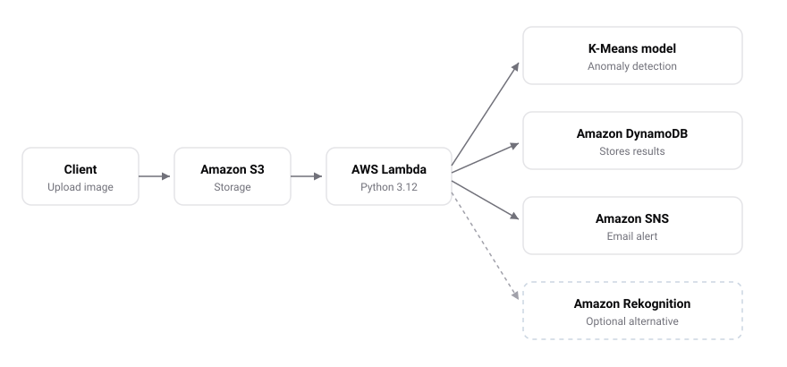
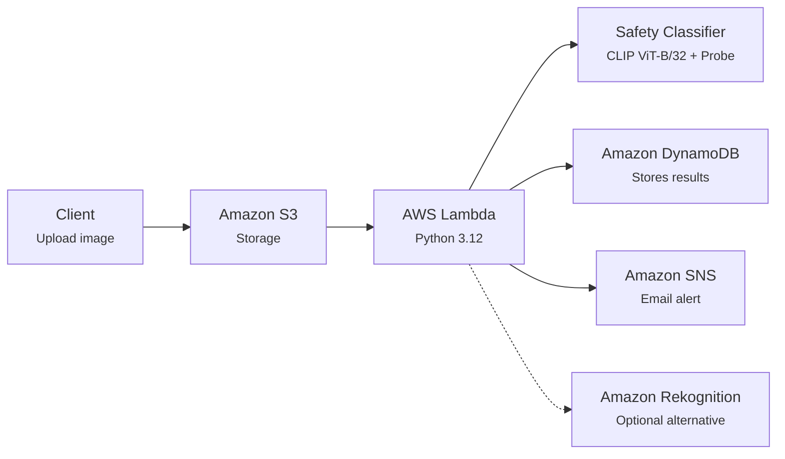

# 🚀 Serverless Image Safety & Threat Classification Pipeline on AWS (CLIP + Terraform)


An automated, event-driven image safety and threat classification system built on **Amazon Web Services (AWS)** and provisioned via **Infrastructure as Code (Terraform)**.

The pipeline combines a serverless **Deep Learning Safety Classifier (frozen CLIP ViT-B/32 embeddings + calibrated linear probe)** with cloud-native automation (**Amazon S3, AWS Lambda, Amazon DynamoDB, Amazon SNS**) and optional managed computer vision (**Amazon Rekognition**). It detects firearms and combat weapons while reliably rejecting hard negatives (kitchen cutlery, domestic tools, toys).

---

## 🏛️ Architecture Overview





---

## 🧠 Machine Learning Engine: Supervised Image Safety Classifier

In content moderation and security pipelines, off-the-shelf vision models often misclassify benign objects (e.g., mistaking a kitchen chef knife for a weapon, or failing on firearms). This project implements a dedicated **CLIP-powered image safety classifier** designed for high recall and calibrated uncertainty.

### 1. Visual Feature Backbone (CLIP ViT-B/32)
Each incoming image is mapped to a **512-dimensional $L_2$-normalized dense visual embedding** using the frozen vision transformer `openai/clip-vit-base-patch32`:
- **Parity-verified preprocessing:** Implements pure Pillow/NumPy preprocessing (`preprocess_image_pure_pil`) running in $<15\text{ms}$ that matches HuggingFace's official `CLIPProcessor` with **cosine similarity of 1.000000** ($> 0.999$).
- **Zero heavy runtime dependency:** The classifier weights and intercept are exported to JSON (`classifier_weights.json`), enabling **pure NumPy serverless inference** ($< 5\text{ms}$) in AWS Lambda without needing full PyTorch or Scikit-Learn binaries.

### 2. Stratified Group Cross-Validation & Calibration
- **Leakage Prevention:** Groups near-duplicates and augmented copies using perceptual hashing (`imagehash.phash`) so identical scenes never leak between train, validation, and test splits (70% train / 15% validation / 15% test).
- **Hard Negative Mining:** Enforces $\ge 15\%$ hard negatives (kitchen knives, scissors, workshop tools, water guns, fencing equipment) labeled strictly as `SAFE` (Class 0).
- **Probability Calibration:** Employs Platt scaling (`CalibratedClassifierCV(method='sigmoid')`) to produce reliable posterior probabilities:
  $$P(\text{Dangerous} \mid x) = \frac{1}{1 + e^{-(\alpha \cdot z + \beta)}}$$
- **Shortcut Learning Defense:** Includes a domain source classifier (`train_source_classifier.py`) to verify that the model learns actual weapon geometry rather than dataset background artifacts.

### 3. Three-Tier Decision Policy & S3 Routing
Dual thresholds ($t_{\text{low}}$ and $t_{\text{high}}$) are calibrated strictly on the validation set to balance recall and precision:
1. **`SAFE`** ($P < t_{\text{low}}$): High confidence safe image. Logged to DynamoDB; normal storage.
2. **`REVIEW`** ($t_{\text{low}} \le P < t_{\text{high}}$): Uncertain boundary case. Automatically copied to the S3 `pending_review/` prefix. Terraform provisions an S3 lifecycle rule that transitions these images to **Amazon S3 Glacier** after 30 days and expires them after 90 days.
3. **`DANGEROUS`** ($P \ge t_{\text{high}}$): Confirmed threat. Publishes an immediate security alert via **Amazon SNS** (email/SMS) and logs flags in DynamoDB.

### 4. Production Prevalence Math
While balanced test sets (50% prevalence) show high precision ($> 90\%$), real-world production environments typically exhibit low threat prevalences (e.g., $1\%$ or $0.1\%$). The evaluation pipeline reports precision adjusted for real-world base rates $\pi$:
$$\text{Precision}(\pi) = \frac{\text{Recall} \times \pi}{\text{Recall} \times \pi + \text{FPR} \times (1 - \pi)}$$

---

## 🔬 Auxiliary Engine: Unsupervised Anomaly Detection (K-Means)

In addition to the supervised CLIP classifier, the repository maintains an **Unsupervised K-Means Anomaly Detection Engine** in `ml_unsupervised/`:
- Extracts a 64-dimensional feature vector (color histograms, luminance gradients, statistical moments).
- Clusters normal image patterns into $K=3$ centroids and defines an anomaly boundary:
  $$\tau = \mu_{\text{dist}} + 2.5 \times \sigma_{\text{dist}}$$
- Plugs into AWS Lambda (`lambda_unsupervised.py`) via the configurable `ENGINE` environment variable (`CLIP_SUPERVISED`, `UNSUPERVISED_KMEANS`, or `REKOGNITION`).

---

## 🛠️ Key Technologies & AWS Services

- **Computer Vision & ML:** OpenAI CLIP (ViT-B/32), Scikit-Learn, PyTorch, Pure NumPy inference
- **Serverless Compute:** AWS Lambda (Python 3.12 / Event-driven S3 triggers)
- **Object Storage & Lifecycle:** Amazon S3 (AES-256 encryption, Glacier transition & expiration rules)
- **NoSQL Database:** Amazon DynamoDB (On-Demand capacity, single-digit millisecond latency)
- **Messaging & Alerting:** Amazon SNS (Automated security incident notifications)
- **Infrastructure as Code (IaC):** HashiCorp Terraform
- **CI/CD & Testing:** GitHub Actions, Python `unittest`

---

## 📂 Repository Structure

```
├── .github/workflows/
│   └── ci.yml                     # Automated GitHub Actions test workflow
├── architecture/
│   └── diagram.svg                # Clean vector architecture diagram
├── data/
│   └── SOURCES.md                 # Public data sources, licenses & attribution registry
├── ml_supervised/
│   ├── data_loader.py             # Stratified group split (70/15/15) & pHash deduplication
│   ├── download_datasets.py       # Automated COCO val2017 & Open Images downloader
│   ├── feature_extractor.py       # CLIP ViT-B/32 pure PIL & PyTorch feature extractor
│   ├── inspect_grid.py            # Visual contact sheet generator (50 samples/class)
│   ├── train_source_classifier.py # Domain shortcut & style artifact detector
│   ├── train_mvp.py               # 5-fold CV, sigmoid calibration & double thresholding
│   ├── evaluate.py                # Single test evaluation (prevalences 50%, 1%, 0.1%)
│   └── lambda_supervised.py       # Production serverless handler with pending_review routing
├── ml_unsupervised/
│   ├── feature_extractor.py       # 64-dim image feature extractor
│   ├── kmeans_engine.py           # K-Means clustering & Euclidean outlier engine
│   ├── kmeans_model.json          # Exported centroids & decision threshold
│   ├── train_kmeans.py            # Unsupervised training script
│   ├── detect_anomaly.py          # CLI anomaly detector
│   └── lambda_unsupervised.py     # Production AWS Lambda ML handler
├── src/
│   └── lambda_function.py         # Rekognition & S3 event handler
├── tests/
│   ├── mock_event.json            # S3 test payload
│   ├── test_classifier.py         # CLIP preprocessing & inference parity tests
│   └── test_lambda.py             # Automated AWS Lambda handler tests
├── web/
│   ├── app.py                     # Local web server & AWS API bridge
│   └── index.html                 # Interactive drag-and-drop dashboard
├── terraform/
│   ├── main.tf                    # Complete infrastructure definition (with S3 lifecycle)
│   ├── variables.tf               # Configurable parameters (engine selector)
│   ├── outputs.tf                 # Resource ARNs and outputs
│   └── terraform.tfvars.example
├── requirements.txt               # Pinned dependencies (Torch, Transformers, Sklearn)
├── .gitignore
└── README.md
```

---

## 📦 Dataset

This repository does not include any dataset. To reproduce the results, download public datasets yourself and respect their licenses.

- **Safe images:** [COCO val2017](http://images.cocodataset.org/zips/val2017.zip) (5,000 images, ~780 MB, varied Flickr CC licenses), [Open Images V7](https://storage.googleapis.com/openimages/web/index.html), [Places365](http://places2.csail.mit.edu/)
- **Hard negatives (kitchen knives, toys, tools):** Open Images V7 (`Kitchen knife`, `Scissors`, `Axe`, `Toy`), COCO cutlery and sporting goods
- **Weapon images:** Public weapon-detection datasets on [Roboflow Universe Weapon Detection](https://universe.roboflow.com/subhransu-sekhar/weapon-detection-o8uoi) or [Kaggle Weapon Detection Dataset (Guns & Knives)](https://www.kaggle.com/datasets/itsahmad/weapon-detection-dataset) and [Kaggle Tactical Knife Dataset](https://www.kaggle.com/datasets/vencerlanz09/knife-dataset) (check the license of each one before downloading)

Place them under `data/raw/` as described in [`data/SOURCES.md`](./data/SOURCES.md):

```
data/raw/
├── safe/
│   ├── coco/                      # Extracted COCO val2017 photos
│   └── hard_negatives/            # Domestic knives, tools, scissors, toys
└── dangerous_manual/              # Guns, rifles, combat knives (min 100 images)
```

Then run:

```bash
# 1. Automated download of safe baseline (COCO val2017)
python3 ml_supervised/download_datasets.py

# 2. Extract CLIP embeddings, tune Logistic Regression via 5-fold CV & calibrate thresholds
python3 ml_supervised/train_mvp.py

# 3. Evaluate final test metrics (AUC-ROC, PR curve, worst FPs/FNs)
python3 ml_supervised/evaluate.py
```

---

## ⚠️ Limitations

This is a learning project. The classifier is trained on public datasets and may fail on small, hidden or unusual weapons. It is not a replacement for a managed moderation service such as Amazon Rekognition.

---

## 🧪 Testing Locally

### 1. Run Automated Unit Tests:
```bash
python3 -m unittest discover tests
```

### 2. Train and Run the Supervised Safety Classifier:
```bash
# Check dataset quota gate (requires >= 100 dangerous images in data/raw/dangerous_manual/)
python3 ml_supervised/sources_registry.py

# Generate contact sheet for human visual audit before training
python3 ml_supervised/inspect_grid.py

# Train calibrated classifier on CLIP embeddings
python3 ml_supervised/train_mvp.py

# Evaluate test metrics and worst false positives/negatives
python3 ml_supervised/evaluate.py
```

### 3. Launch the Interactive Web Dashboard:
```bash
python3 web/app.py
# Open http://localhost:8000 in your browser to test drag-and-drop uploads
```

---

## 🚀 Cloud Deployment (Terraform)

1. **Configure AWS Credentials:**
   ```bash
   aws configure
   ```

2. **Deploy with Terraform:**
   ```bash
   cd terraform
   cp terraform.tfvars.example terraform.tfvars
   # Configure alert_email, aws_region, and engine (default: CLIP_SUPERVISED)

   terraform init
   terraform plan
   terraform apply
   ```

3. **Verify Deployment:**
   - Upload an image to the generated S3 bucket:
     ```bash
     aws s3 cp image.jpg s3://$(terraform output -raw s3_bucket_name)/
     ```
   - Check DynamoDB for the classification result and confidence score.
   - If marked `REVIEW`, the image is automatically copied to `pending_review/` with Glacier lifecycle transitions.
   - If marked `DANGEROUS`, an immediate SNS security alert email is delivered.

4. **Cleanup (Zero cost):**
   ```bash
   terraform destroy
   ```
