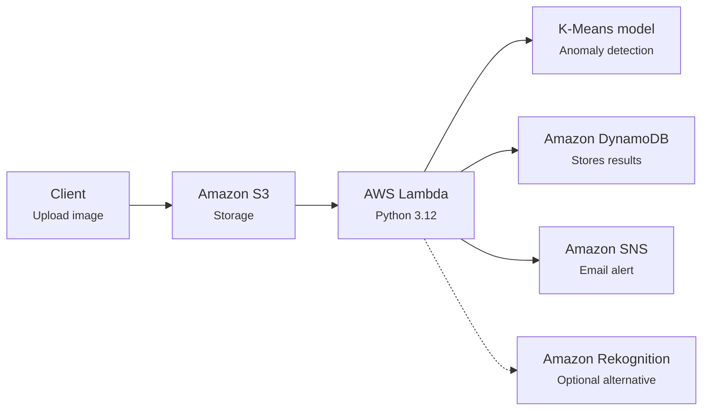

# 🚀 Event-Driven Image Analysis & Unsupervised ML Pipeline with AWS & Terraform


An automated, serverless, event-driven image analysis and **Unsupervised Machine Learning anomaly detection pipeline** built on **Amazon Web Services (AWS)** and provisioned via **Infrastructure as Code (Terraform)**. 

The system combines managed cloud computer vision (**Amazon Rekognition**) with a custom **Unsupervised K-Means clustering algorithm** running serverless on **AWS Lambda** to detect suspicious content and anomalies without requiring pre-labeled training data.

---

## 🏛️ Architecture Overview




---

## 🧠 Unsupervised Machine Learning Engine (K-Means Anomaly Detection)

In high-security and content moderation environments, labeled threat datasets are rarely available. This project implements an **Unsupervised Learning** approach: the model learns the mathematical baseline of normal images and flags statistical outliers as anomalies.

### 1. Feature Engineering (`feature_extractor.py`)
Each incoming image is transformed into a **64-dimensional numerical feature vector** in $<5\text{ms}$:
- **Color Distributions (48 features):** 16-bin histograms across color projections.
- **Edge & Gradient Gradients (8 features):** Luminance contrast and edge density.
- **Statistical Moments (4 features):** Mean intensity, variance, standard deviation, and energy.
- **Compression & Highlight Density (4 features):** Shadow/highlight distribution and entropy proxies.

### 2. K-Means Clustering & Decision Boundary (`kmeans_engine.py`)
- Groups baseline images into $K=3$ distinct geometric clusters without supervision ($Y$ labels do not exist).
- Iteratively computes optimal cluster centroids $\mu_1, \mu_2, \dots, \mu_K$.
- Computes an automated statistical anomaly threshold:
  $$\tau = \mu_{\text{dist}} + 2.5 \times \sigma_{\text{dist}}$$

### 3. Real-Time Outlier Prediction
For any new image vector $x$, the Euclidean distance to the nearest centroid is evaluated:
$$d(x) = \min_{k} \|x - \mu_k\|_2$$
- If $d(x) \le \tau$ : The image conforms to normal patterns (**Normal**).
- If $d(x) > \tau$ : The image is a statistical outlier (**Suspicious / Anomaly Detected**).

### 4. Cloud Serverless Integration (`lambda_unsupervised.py`)
The trained model (`kmeans_model.json`) is loaded outside the Lambda handler (warm start) to deliver **sub-10ms serverless inference** directly inside the AWS ingestion pipeline.

---

## 🛠️ Key Technologies & AWS Services

- **Compute & Serverless ML:** AWS Lambda (Python 3.12 / Boto3 / NumPy-free pure ML)
- **Machine Learning:** Unsupervised K-Means Clustering, Euclidean Anomaly Detection, In-Browser Computer Vision
- **Storage:** Amazon S3 (Server-Side Encryption AES-256, Block Public Access)
- **Database:** Amazon DynamoDB (NoSQL, On-Demand Capacity, Single-digit ms latency)
- **Managed AI:** Amazon Rekognition (Computer Vision: Object Detection & Content Moderation)
- **Alerting & Messaging:** Amazon SNS (Publish/Subscribe Automated Security Alerts)
- **Monitoring & Security:** Amazon CloudWatch Logs & IAM (Principle of Least Privilege)
- **Infrastructure as Code (IaC):** HashiCorp Terraform
- **CI/CD:** GitHub Actions

---

## 📂 Repository Structure

```
├── .github/workflows/
│   └── ci.yml                     # Automated GitHub Actions test workflow
├── architecture/
│   └── diagram.svg                # Clean vector architecture diagram
├── data/
│   └── SOURCES.md                 # Public data sources, licenses & attribution registry
├── ml_supervised/
│   ├── data_loader.py             # Stratified group split (70/15/15) & pHash deduplication
│   ├── download_datasets.py       # Automated COCO val2017 & Open Images downloader
│   ├── feature_extractor.py       # CLIP ViT-B/32 pure PIL & PyTorch feature extractor
│   ├── inspect_grid.py            # Visual contact sheet generator (50 samples/class)
│   ├── train_source_classifier.py # Domain shortcut & style artifact detector
│   ├── train_mvp.py               # 5-fold CV, sigmoid calibration & double thresholding
│   ├── evaluate.py                # Single test evaluation (prevalences 50%, 1%, 0.1%)
│   └── lambda_supervised.py       # Production serverless handler with pending_review routing
├── ml_unsupervised/
│   ├── feature_extractor.py       # 64-dim image feature extractor
│   ├── kmeans_engine.py           # K-Means clustering & Euclidean outlier engine
│   ├── kmeans_model.json          # Exported centroids & decision threshold
│   ├── train_kmeans.py            # Unsupervised training script
│   ├── detect_anomaly.py          # CLI anomaly detector
│   └── lambda_unsupervised.py     # Production AWS Lambda ML handler
├── src/
│   └── lambda_function.py         # Rekognition & S3 event handler
├── tests/
│   ├── mock_event.json            # S3 test payload
│   ├── test_classifier.py         # CLIP preprocessing & inference parity tests
│   └── test_lambda.py             # Automated AWS Lambda handler tests
├── web/
│   ├── app.py                     # Local web server & AWS API bridge
│   └── index.html                 # Interactive drag-and-drop dashboard
├── terraform/
│   ├── main.tf                    # Complete infrastructure definition (with S3 lifecycle)
│   ├── variables.tf               # Configurable parameters (engine selector)
│   ├── outputs.tf                 # Resource ARNs and outputs
│   └── terraform.tfvars.example
├── requirements.txt               # Pinned dependencies (Torch, Transformers, Sklearn)
├── .gitignore
└── README.md
```

---

## 📦 Dataset

This repository does not include any dataset. To reproduce the results, download public datasets yourself and respect their licenses.

- **Safe images:** [COCO val2017](http://images.cocodataset.org/zips/val2017.zip) (5,000 images, ~780 MB, varied Flickr CC licenses), [Open Images V7](https://storage.googleapis.com/openimages/web/index.html), [Places365](http://places2.csail.mit.edu/)
- **Hard negatives (kitchen knives, toys, tools):** Open Images V7 (`Kitchen knife`, `Scissors`, `Axe`, `Toy`), COCO cutlery and sporting goods
- **Weapon images:** Public weapon-detection datasets on [Roboflow Universe Weapon Detection](https://universe.roboflow.com/subhransu-sekhar/weapon-detection-o8uoi) or [Kaggle Weapon Detection Dataset (Guns & Knives)](https://www.kaggle.com/datasets/itsahmad/weapon-detection-dataset) and [Kaggle Tactical Knife Dataset](https://www.kaggle.com/datasets/vencerlanz09/knife-dataset) (check the license of each one before downloading)

Place them under `data/raw/` as described in [`data/SOURCES.md`](./data/SOURCES.md):

```
data/raw/
├── safe/
│   ├── coco/                      # Extracted COCO val2017 photos
│   └── hard_negatives/            # Domestic knives, tools, scissors, toys
└── dangerous_manual/              # Guns, rifles, combat knives (min 100 images)
```

Then run:

```bash
# 1. Automated download of safe baseline (COCO val2017)
python3 ml_supervised/download_datasets.py

# 2. Extract CLIP embeddings, tune Logistic Regression via 5-fold CV & calibrate thresholds
python3 ml_supervised/train_mvp.py

# 3. Evaluate final test metrics (AUC-ROC, PR curve, worst FPs/FNs)
python3 ml_supervised/evaluate.py
```

---

## ⚠️ Limitations

This is a learning project. The classifier is trained on public datasets and may fail on small, hidden or unusual weapons. It is not a replacement for a managed moderation service such as Amazon Rekognition.

---

## 🧪 Testing Locally

### 1. Run Automated Unit Tests:
```bash
python3 -m unittest discover tests
```

### 2. Train and Run the Unsupervised ML Model:
```bash
# Train K-Means centroids and compute threshold
python3 ml_unsupervised/train_kmeans.py

# Test anomaly detection on any image file
python3 ml_unsupervised/detect_anomaly.py path/to/image.jpg
```

### 3. Launch the Interactive Web Dashboard:
```bash
python3 web/app.py
# Open http://localhost:8000 in your browser to test drag-and-drop uploads
```

---

## 🚀 Cloud Deployment (Terraform)

1. **Configure AWS Credentials:**
   ```bash
   aws configure
   ```

2. **Deploy with Terraform:**
   ```bash
   cd terraform
   cp terraform.tfvars.example terraform.tfvars
   # Configure alert_email and aws_region in terraform.tfvars

   terraform init
   terraform plan
   terraform apply
   ```

3. **Verify Deployment:**
   - Upload an image to the generated S3 bucket:
     ```bash
     aws s3 cp image.jpg s3://$(terraform output -raw s3_bucket_name)/
     ```
   - Check DynamoDB for the generated analysis record and ML anomaly score.
   - If an anomaly is detected, check your inbox for an instant SNS security alert.

4. **Cleanup (Zero cost):**
   ```bash
   terraform destroy
   ```
